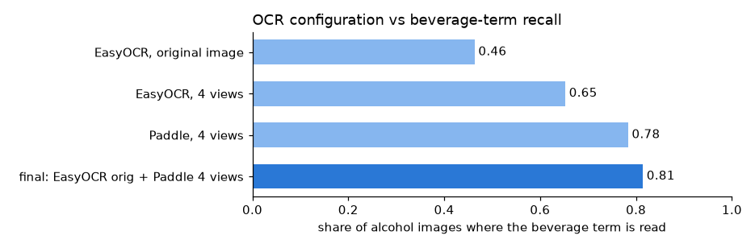
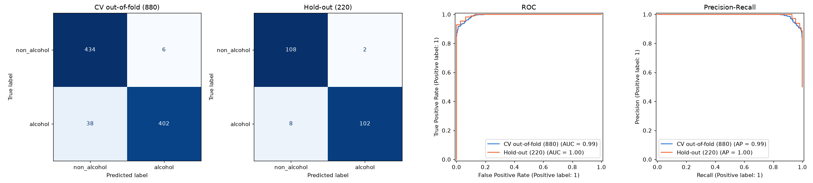
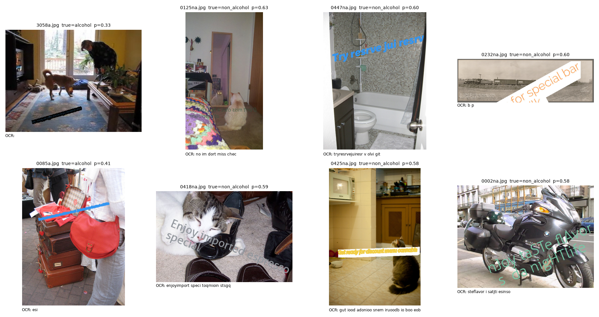

# Detecting alcohol references in superimposed image text

## Summary

| | Precision | Recall | F1 | ROC-AUC |
|---|---|---|---|---|
| 5-fold CV (880 images) | 0.985 | 0.914 | **0.948** | 0.993 |
| Hold-out, not used for any choice (220 images) | 0.981 | 0.927 | **0.953** | 0.996 |

* **OCR is the bottleneck.** The text is rendered adversarially. One EasyOCR pass reads the deciding word in 46% of
  alcohol images. Two OCR engines on mirrored and colour-channel views read it in 81%, and that alone lifts F1 from
  0.81 to 0.94.
* **Domain knowledge carries generalisation.** On drink and brand names never seen in training, the text model alone
  drops to F1 0.71; with the alcohol lexicon fused in, it stays at 0.93.
* **The model is never confidently wrong.** Every error has 0.33 < p < 0.64. Routing the 13% most uncertain images to
  review gives 99.2% accuracy on the rest.

## 1. Data

1,100 photos (550 per class) with synthetic overlay text. Visual inspection and OCR statistics
([notebook](../notebooks/01_eda_and_results.ipynb)) show:

* **The label is one word.** Both classes use the same marketing templates ("Don't miss limited edition … event"). Only
  the beverage decides: *lager, port, bourbon, Heineken…* vs *coffee, matcha, lemonade, energy drink, cannabis…*
* **Adversarial rendering:** mirrored text, rotated banners, curved text, outlined or low-contrast fonts, random case
  (`nJoy taSTe`), leetspeak (`br3w`), repeated phrases, and scene text in the photo itself.
* **Traps:** alcohol-sounding confounders ("brew", "bar", "party") are equally common in both classes. Some template
  words are skewed by the generator ("dont miss" in 11% of alcohol vs 4% of non-alcohol texts; "enjoy" only in
  non-alcohol). A model must not learn either.

## 2. Pipeline

```
image → OCR: EasyOCR (original) + PaddleOCR (original, mirrored, saturation, saturation-mirrored)
      → text: lowercase, de-leet (3→e, 0→o), de-duplicate, drop template words
      → TF-IDF char 2-5 + word 1-2 grams → logistic regression → p
      → late fusion with alcohol lexicon → threshold 0.57 → alcohol / non_alcohol
```

* **Mirrored view:** mirrored text is unreadable without it. **Saturation channel:** coloured overlay fonts stand
  out while the photo flattens. **Two engines:** Paddle is the stronger engine, and EasyOCR's errors complement it.
* **Char n-grams + logistic regression:** tolerant to OCR typos (the model uses fragments such as `" cha"` and
  `"bud"`), fast on CPU, and inspectable.
* **Lexicon** (`src/lexicon.py`):
  * 228 alcohol terms (beer, wine, spirits, cocktails, brands) and 48 decoys (root beer, non-alcoholic, coffee,
    cannabis…).
  * Negation handling ("zero proof gin").
  * OCR-aware matching: exact for short words (*port ≠ imported*), fuzzy for long ones, `rn→m` ("smimoff" =
    Smirnoff), and glued or split words ("bourbonevent").
* **Late fusion:** an alcohol term with no decoy → p ≥ 0.95; a decoy with no alcohol term → p ≤ 0.05; otherwise the
  model decides. Feeding lexicon features *into* the regression was tried and cost 13 points of recall: the
  near-perfect "term found" feature taught it that "no term ⇒ non-alcohol".
* **Template stripping:** before it, "dont miss" alone scored p=0.97; after it, template-only text scores ≈0.5. CV F1
  was unchanged.

## 3. Metrics

* **OCR (intermediate):** there are no transcripts, so the metric is the share of alcohol images where the lexicon
  finds an alcohol term in the OCR text (and decoys for non-alcohol). This measures exactly what the classifier needs.
* **Final:** precision, recall and F1 at the threshold, plus ROC-AUC. For DV, a false negative is a brand-safety
  incident and a false positive is blocked safe inventory, so the threshold is a business knob. It was tuned for F1 on
  out-of-fold predictions; at 0.5 recall is 0.971 at precision 0.918.
* **Protocol:** stratified 80/20 split. Every choice (OCR views, C, threshold, template stripping) was made with
  5-fold CV on the 80%; the 20% hold-out was only used for reporting.

## 4. Results



| 5-fold CV | Precision | Recall | F1 |
|---|---|---|---|
| Lexicon rule (alcohol term found) | 0.997 | 0.811 | 0.895 |
| TF-IDF logistic regression | 0.916 | 0.971 | 0.943 |
| **Fusion (final)** | **0.985** | 0.914 | **0.948** |
| *Same final model, other OCR:* EasyOCR original only | 0.802 | 0.811 | 0.807 |
| EasyOCR 4 views | 0.908 | 0.925 | 0.917 |
| Paddle 4 views | 0.897 | 0.950 | 0.923 |

**Unseen drink and brand names** (grouped CV: every test fold contains only beverage names absent from training):
TF-IDF alone F1 0.705 (AUC 0.78) vs fusion **0.934** (AUC 0.99). The text model memorises brands; the lexicon covers
new ones. That covers only brands that are *in* the lexicon, so extending it is the cheapest production improvement.



## 5. Failure cases



1. **OCR reads nothing useful** (3058a, 0085a): thin or small text on a narrow stripe.
2. **Beverage word misread or truncated** (0447na "jui resrv" for juice, 0425na unreadable cannabis).
3. **No beverage word at all** (0002na, 0232na "bar special"): only template words and confounders.
4. **Scene text:** real signs and watermarks in the photo mix into the OCR text (e.g. a "COLD BEER" sign under a
   "sparkling water" overlay).

## 6. Improvements with more time

1. **Text-region rectification:** crop each detected text box, deskew, upscale and re-OCR it (targets failures 1-2).
2. **Overlay vs scene text:** filter OCR boxes by banner background, uniform colour and confidence (failure 4).
3. **Cascade for speed:** run 2 views first and the rest only when undecided, about 2-3× faster.
4. **Lexicon coverage:** more brands, local drinks and languages; for unknown words, a cached "is X alcoholic?" check
   with an embedding model or an LLM.
5. **Review queue:** route the uncertain band to a heavier model or a human, and feed the answers back as training data.

## 7. Running

`python predict.py --input_dir <dir>` writes `results.csv`. On a 4-core laptop CPU this takes 8-13 s/image. Full
reproduction steps are in the [README](../README.md).
